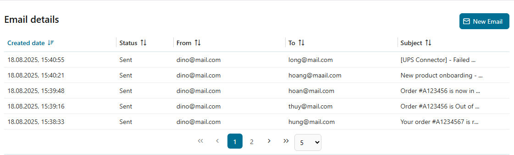
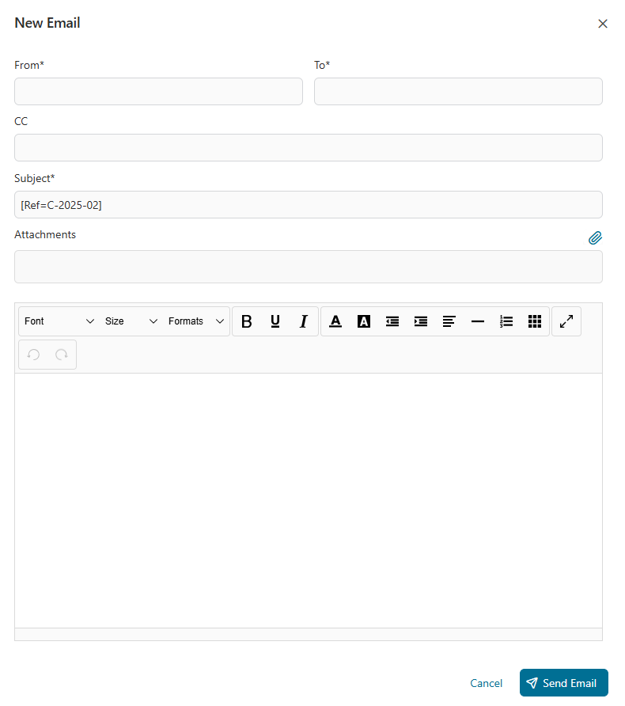
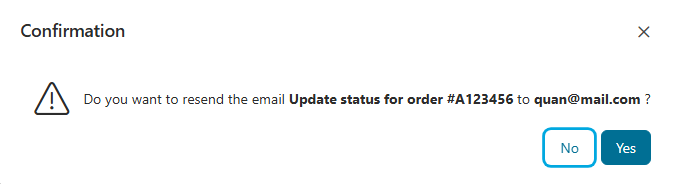
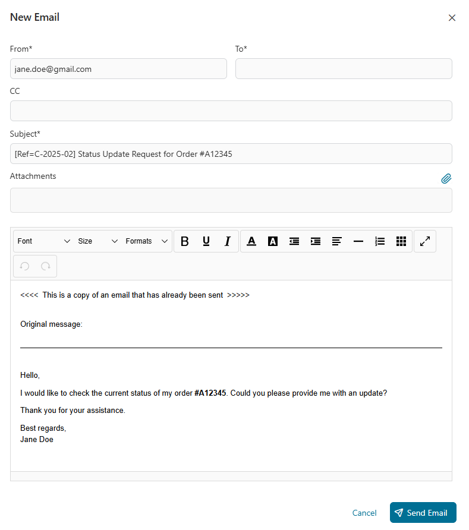
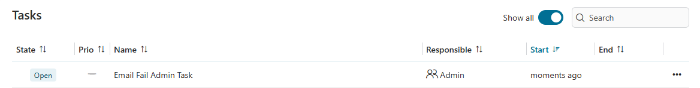
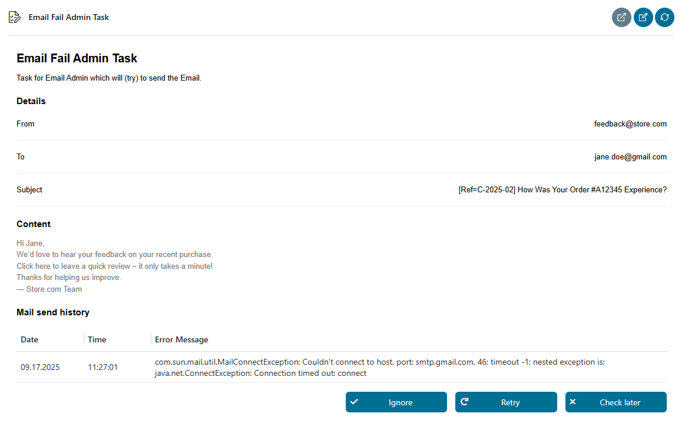

# Case-Mail-Komponente

Eine einfache E-Mail-Komponente zum Senden und Empfangen von Nachrichten, die einem bestimmten Ivy-Fall zugeordnet sind. Gesendete E-Mails werden automatisch mit dem zugehörigen Fall verknüpft. So lässt sich die Kommunikation im Workflow nachvollziehen und verwalten.

Die Case-Mail-Komponente unterstützt das Senden, Empfangen, Beantworten, Weiterleiten und erneute Senden von E-Mails, die mit einem Ivy-Fall verknüpft sind.
- Eine E-Mail-Listenansicht zeigt wichtige Informationen wie Datum, Absender, Empfänger und Betreff.
- Detailansichten und die Integration in Prozesse ermöglichen eine lückenlose Nachverfolgung der Kommunikation.
- Die Komponente unterstützt Feldvalidierung, Fehlerbehandlung mit Wiederholungsversuchen und die Verwaltung von Admin-Aufgaben für fehlgeschlagene E-Mails.
- Der Inhalt und die Anhänge der Originalnachricht bleiben beim Antworten, Weiterleiten und erneuten Senden erhalten.

## Demo

### E-Mail-Listenansicht
Zeigt eine Liste aller E-Mails.



### E-Mail-Detailansicht
Zeigt alle Details einer ausgewählten E-Mail.


### Neue E-Mail
- Ermöglicht das Verfassen und Senden neuer E-Mails.
- Feldvalidierungen:
  - `From`: Pflichtfeld; muss eine gültige E-Mail-Adresse enthalten.
  - `To`: Pflichtfeld; muss eine gültige Liste von E-Mail-Adressen enthalten.
  - `CC`: Optional; falls angegeben, muss der Wert eine gültige Liste von E-Mail-Adressen enthalten.



### Antwort-E-Mail
Die Felder werden automatisch anhand der ursprünglichen E-Mail ausgefüllt:
- `Subject`: erhält das Präfix `RE:`.
- `Body`:
  ```
  <neue Nachricht>

  Von: <ursprünglicher Absender>
  Gesendet: <ursprüngliches Sendedatum>
  An: <ursprüngliche Empfänger>
  CC: <ursprüngliche CC-Empfänger>
  Betreff: <ursprünglicher Betreff>
  <ursprünglicher Text>
  ```


### E-Mail weiterleiten
Dient zum Weiterleiten empfangener Nachrichten:
- `From`: ursprünglicher Absender.
- `To`: vom Benutzer festgelegt.
- `Subject`: erhält das Präfix `FW:`.
- `Body`: enthält die vollständigen Angaben zur Originalnachricht.
- Anhänge: Die ursprünglichen Anhänge werden übernommen.


### E-Mail erneut senden
- Nur für E-Mails mit dem Status `Sent` verfügbar.
- Sendet eine bereits versendete E-Mail erneut:
  - `From`, `To`, `Subject`: wie in der Originalnachricht.
  - `Body`:
    ```
    <<<<  Dies ist eine Kopie einer bereits gesendeten E-Mail  >>>>>

    Originalnachricht:
    <ursprünglicher Text>
    ```
  - Anhänge: Die ursprünglichen Anhänge werden übernommen.





### Fehlerbehandlung
- Automatischer Wiederholungsmechanismus:
  - Die Anzahl der Wiederholungsversuche und das Intervall werden über folgende Variablen konfiguriert:
    - `mailLoopRepeatNumber`
    - `mailLoopRepeatDelay`
- Schlagen alle Wiederholungsversuche fehl, wird eine Admin-Aufgabe erstellt.

### Admin-Aufgaben
- **Abbrechen:** Bricht die Aufgabe ab und beendet den Prozess.
- **Erneut versuchen:** Versucht, die E-Mail erneut zu senden. Schlägt der Versand fehl, wird die konfigurierte Wiederholungslogik angewendet und bei Bedarf eine weitere Admin-Aufgabe erstellt.





### Empfangene E-Mails
Die Komponente ruft alle E-Mails aus dem Postfach ab, deren Betreff dem in der Variablen `subjectMatches` definierten Muster entspricht.

Enthält der Betreff eine gültige Fallreferenz gemäß der Variablen `caseReferenceRegex`, wird die E-Mail in den Ordner `processedFolderName` verschoben. Andernfalls wird sie in den Ordner `errorFolderName` verschoben.

Nach der Verarbeitung der E-Mail wird eine Aufgabe für einen Benutzer mit der in der Variablen `retrieveMailTaskRole` definierten Rolle erstellt.

## Konfiguration

1. **Maximale Größe des Request-Bodys konfigurieren**

   Legen Sie die maximale Größe (in Byte) des Request-Bodys fest, den der Server bei folgenden Vorgängen zwischenspeichern oder speichern soll:
   - FORM- oder CLIENT-CERT-Authentifizierung
   - HTTP/1.1-Upgrade-Anfragen

   **Konfiguration in `ivy.yaml`:**
   ```yaml
   Http:
     MaxPostSize: 2097152
   ```
   👉 Referenz: [Axon Ivy Docs – ivy.yaml](https://developer.axonivy.com/doc/14.0.0/engine-guide/configuration/files/ivy-yaml.html)

   **Konfiguration in nginx:**
   ```nginx
   client_max_body_size 150M;
   ```

2. **Projektvariablen festlegen**

   Legen Sie in Ihrem Projekt die folgenden Variablen fest:
   ```
   @variables.yaml@
   ```

3. **Ordner im Postfach einrichten**

   Wenn Sie die Funktion zum Empfangen von E-Mails verwenden, legen Sie in Ihrem Postfach die beiden Ordner an, die in den Variablen `processedFolderName` und `errorFolderName` konfiguriert sind.

## Leitfaden – Empfangene E-Mails und Fallzuordnung

Dieser Abschnitt erklärt, wie eingehende E-Mails mit Fällen verknüpft werden und wie Sie die Komponente an Ihr Projekt anpassen können.

### Speicherung der Fallreferenz

Beim Abrufen einer E-Mail extrahiert die Komponente eine **Fallreferenz** aus dem Betreff, zum Beispiel `C-2025-01` aus `[Ref=C-2025-01]`. Dafür wird die Methode **`getReferenceCaseId(String subject)`** in `AbstractEmailHandler` verwendet. Sie können diese Methode überschreiben und eine eigene Logik implementieren. Die Fallreferenz ist die Zeichenfolge, die angibt, zu welchem Fall die E-Mail gehört.

Diese Zeichenfolge wird im persistenten Feld `caseId` der Entität `Mail` gespeichert. Das bedeutet: **`Mail.caseId` enthält die Fallreferenz**, also die extrahierte Kennung. Alle E-Mails werden im Axon Ivy Repository gespeichert. Es gibt keine direkte Verknüpfung zwischen einer `Mail`-Entität und einem Ivy-Fallobjekt; die Verknüpfung erfolgt ausschließlich über den Wert `caseId`.

### Voraussetzungen, damit E-Mails bei einem Fall angezeigt werden

1. **Betreffformat** – Der Betreff der E-Mail muss Text enthalten, der dem Muster `caseReferenceRegex` entspricht. Die erste Erfassungsgruppe – oder Ihre eigene Logik – bestimmt die Fallkennung. Beispiel: Bei `caseReferenceRegex: \[Ref=(.+?)\]` ergibt der Betreff `Re: Invoice [Ref=C-2025-01]` die Kennung `C-2025-01`. Standardmäßig wird sie im Feld `caseId` der `Mail`-Entität gespeichert.

2. **Fall-UI** – Verwenden Sie in dem Prozess oder auf der Seite, auf der Sie die E-Mails eines Falls anzeigen, die Komponente `MailBrowser`. Übergeben Sie ihr über das Attribut `caseId` dieselbe Kennung, zum Beispiel `caseId="#{data.caseId}"`. Der `MailBrowser` zeigt E-Mails an, deren `Mail.caseId` diesem Wert entspricht. Die übergebene Kennung muss daher mit dem beim Abrufen der E-Mail gespeicherten Wert übereinstimmen.

### Speicherort und Verknüpfung importierter E-Mails

- **Speicherung:** Importierte E-Mails werden als Geschäftsdaten-Entitäten vom Typ `Mail` im Axon Ivy Repository gespeichert. Anhänge werden als Entitäten vom Typ `Attachment` gespeichert und über `mailId` mit der E-Mail verknüpft. Die Originalnachricht kann ebenfalls als Anhang gespeichert werden, zum Beispiel als `.eml`-Datei.
- **Verknüpfung:** Es gibt keinen direkten Verweis auf einen Ivy-Fall oder -Prozess und keinen Fremdschlüssel zu `ICase`. Die Verknüpfung erfolgt über einen Zeichenfolgenvergleich: Das Feld `caseId` jeder E-Mail wird auf den bei der Verarbeitung zurückgegebenen Wert gesetzt. Wird derselbe Wert im Attribut `caseId` des `MailBrowser` auf der Fallseite übergeben, fragt die Komponente die E-Mails anhand dieses Werts ab und zeigt sie für den Fall an.

### Wenn es noch keinen Fall mit der extrahierten Referenz gibt

Wird keine gültige Fallreferenz gefunden, wird die E-Mail als E-Mail „ohne Referenz“ behandelt. Sie wird in den Fehlerordner verschoben und eine Benachrichtigung über die nicht zuordenbare E-Mail ausgelöst.

### Extraktion der Fallreferenz anpassen

Standardmäßig verwendet die Komponente die erste Erfassungsgruppe von `caseReferenceRegex` im Betreff als Fallkennung und speichert sie in `Mail.caseId`. Wenn Ihre Fälle nach einem anderen Schema identifiziert werden – zum Beispiel über eine interne UUID oder einen nachzuschlagenden Code –, können Sie die Methode `getReferenceCaseId` in einem benutzerdefinierten E-Mail-Handler überschreiben.

**Aufgabe von `getReferenceCaseId`**

- **Signatur:** `protected String getReferenceCaseId(String subject)`
- **Eingabe:** der Betreff der E-Mail.
- **Ausgabe:** die Zeichenfolge, die in `Mail.caseId` gespeichert werden soll. Dieser Wert verknüpft die E-Mail im `MailBrowser` mit einem Fall. Geben Sie `null` oder eine leere Zeichenfolge zurück, wenn keine gültige Referenz gefunden wird. Die E-Mail wird dann als E-Mail „ohne Referenz“ behandelt.

**Standardverhalten** – `AbstractEmailHandler` liest `caseReferenceRegex` aus den Variablen, wendet den Ausdruck ohne Berücksichtigung der Groß- und Kleinschreibung auf den Betreff an und gibt die erste Erfassungsgruppe zurück, zum Beispiel `C-2025-01` aus `[Ref=C-2025-01]`.

**Beispiele für eigenes Verhalten**

- **Lesbaren Code zurückgeben:** Verwenden Sie das Standardverhalten oder geben Sie die erfasste Zeichenfolge unverändert zurück. Verwenden Sie denselben Code im Attribut `caseId` des `MailBrowser`, zum Beispiel `data.caseId` als Fallcode.
- **Interne Fall-UUID zurückgeben:** Extrahieren Sie in Ihrem Handler den Code aus dem Betreff, suchen Sie den Fall im Repository (zum Beispiel anhand des Geschäftscodes) und geben Sie die interne ID des Falls zurück. Übergeben Sie dieselbe ID an den `MailBrowser`, zum Beispiel mit `caseId="#{ivy.case.getId()}"` oder über das ID-Feld Ihres Falls.
- **Existenz des Falls prüfen:** Suchen Sie anhand des extrahierten Codes nach dem Fall. Wird er nicht gefunden, geben Sie `null` zurück. Die E-Mail wird dann als E-Mail „ohne Referenz“ behandelt und kann manuell bearbeitet werden.

**Benutzerdefinierte Methode `getReferenceCaseId` verwenden**

1. **Benutzerdefinierten E-Mail-Handler erstellen**

   Fügen Sie eine Klasse hinzu, die `AbstractEmailHandler` erweitert, und überschreiben Sie `getReferenceCaseId(String subject)`.

   Beispiel: `CustomEmailHandler` in `case-mail-component-utils-demo`.

2. **Benutzerdefinierten Handler-Generator erstellen**

   Fügen Sie eine Klasse hinzu, die `AbstractEmailHandlerCreator` erweitert und Ihren Handler zurückgibt.

   Beispiel: `CustomEmailHandlerCreator` in `case-mail-component-utils-demo`.

3. **Beim Abrufen der E-Mails den eigenen Generator verwenden**

   Der Ablauf zum Abrufen von E-Mails verwendet `AbstractEmailHandlerCreator`, um den Handler zu erstellen. Damit Ihre Implementierung verwendet wird, müssen Sie den Prozess `HandleRetrieveMail` in Ihrem Projekt überschreiben und dort Ihren Generator statt des Standardgenerators erstellen. Verwenden Sie im Skript vor dem Aufruf der Abruflogik:

   ```java
   AbstractEmailHandlerCreator emailHandlerCreator = new CustomEmailHandlerCreator();
   emailHandlerCreator.retrieveEmails(in.storeName);
   ```

   Der Standardprozess verwendet `DefaultEmailHandlerCreator` und `DefaultEmailHandler`. Ihre Überschreibung verwendet stattdessen `CustomEmailHandlerCreator` und `CustomEmailHandler`.

Danach wird für jede abgerufene E-Mail Ihre Implementierung von `getReferenceCaseId` verwendet. Stellen Sie sicher, dass der zurückgegebene Wert genau dem Wert entspricht, den Sie auf der Fallseite im Attribut `caseId` des `MailBrowser` übergeben. So werden die E-Mails dem richtigen Fall zugeordnet.
