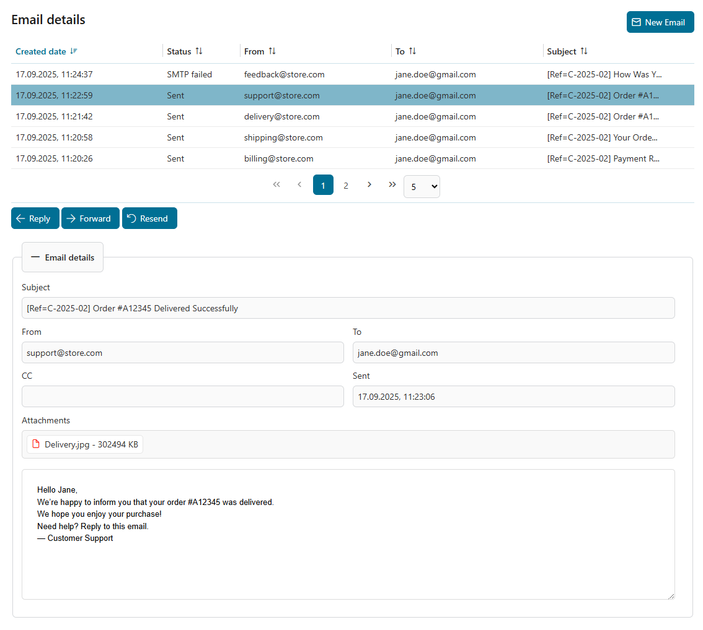
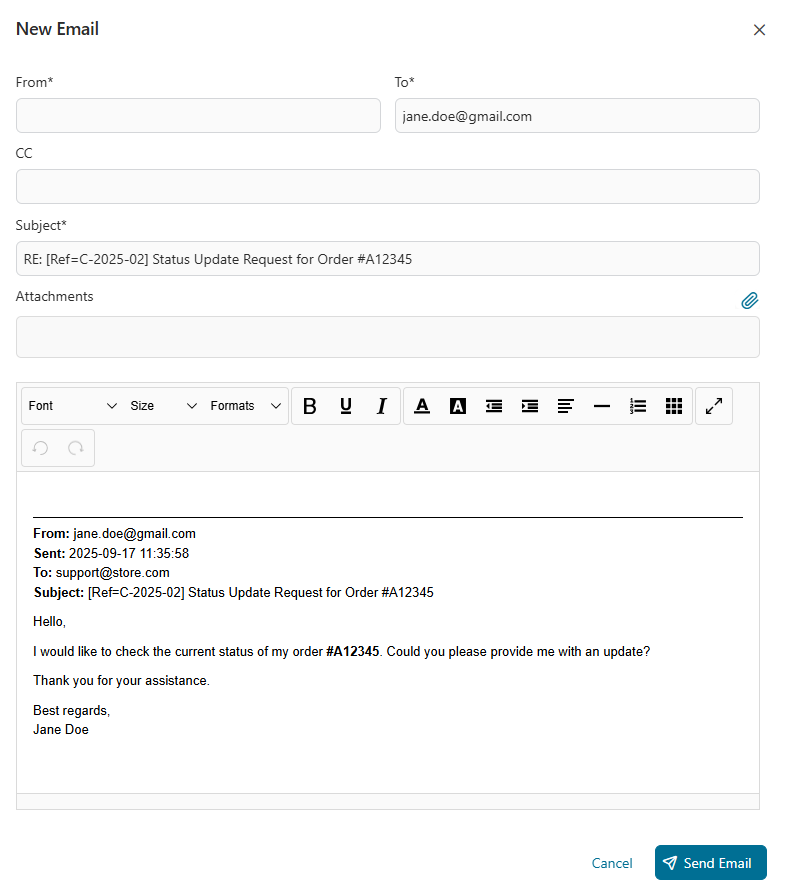
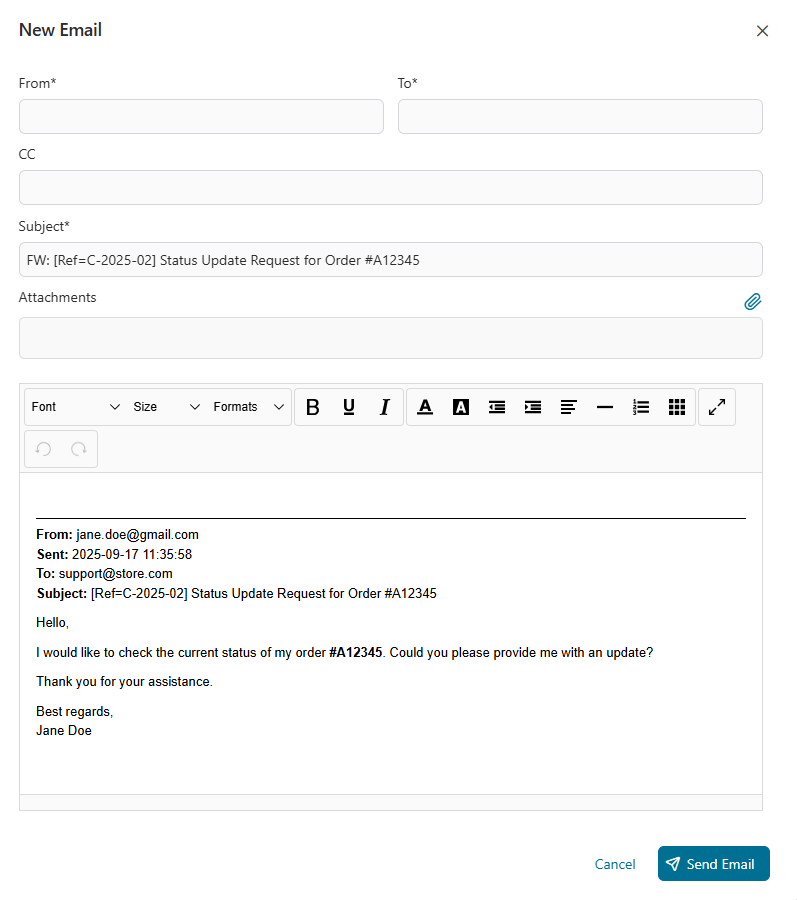

# Case Mail Komponente Utils

Ein kompaktes E-Mail-Modul zum Senden und Empfangen von Nachrichten, die einem
bestimmten Ivy-Case zugeordnet sind. Alle ausgehenden E-Mails werden automatisch
mit dem jeweiligen Case verknüpft – so bleibt die gesamte Kommunikation
jederzeit nachvollziehbar und zentral im Workflow verfügbar.

Der Case Mail Komponente unterstützt das Versenden, Empfangen, Beantworten,
Weiterleiten und erneute Versenden von E-Mails.
- Eine Listenansicht zeigt die wichtigsten Informationen wie Datum, Absender,
  Empfänger und Betreff.
- Detailansichten und die Integration in Prozesse sorgen für eine lückenlose
  Nachverfolgung.
- Eingaben werden validiert, Fehler automatisch behandelt und bei Bedarf wird
  fehlgeschlagenes Versenden erneut versucht; fehlgeschlagene Nachrichten
  erzeugen eine Admin-Aufgabe.
- Inhalt und Anhänge bleiben bei Antworten, Weiterleitungen und erneutem Versand
  vollständig erhalten.

## Demo
### E-Mail-Listenansicht
Übersicht aller E-Mails zu einem Fall.


### E-Mail-Details
Anzeige der vollständigen Informationen zu einer ausgewählten Nachricht.




### Neue E-Mail
- Erstellen und Versenden neuer Nachrichten.
- Validierungen:
  - `From`: Pflichtfeld; gültige Adresse erforderlich.
  - `To`: Pflichtfeld; gültige Liste von Adressen erforderlich.
  - `CC`: Optional; falls angegeben, gültige Liste von Adressen.


### Antwort-E-Mail
Automatische Übernahme der wichtigsten Daten der ursprünglichen Nachricht:
  - `Subject`: wird mit `RE:` ergänzt
  - `Body`: enthält die ursprüngliche Nachricht mit Absender, Datum, Empfänger,
    Betreff und Text
    ```
    <neue Nachricht>

    Von: <ursprünglicher Absender>
    Gesendet: <ursprüngliches Sendedatum>
    An: <ursprünglicher Empfänger>
    CC: <ursprüngliche CC-Empfänger>
    Betreff: <ursprünglicher Betreff>
    <ursprünglicher Text>
    ```




### E-Mail weiterleiten
Weiterleitung eingegangener Nachrichten:
  - `From`: ursprünglicher Absender
  - `To`: vom Benutzer definiert
  - `Subject`: wird mit `FW:` ergänzt
  - `Body`: enthält die gesamte Originalnachricht
  - Anhänge: werden übernommen



### E-Mail erneut senden
- Verfügbar nur für Nachrichten mit Status `Sent`
- Sendet eine E-Mail erneut mit denselben Daten (Absender, Empfänger, Betreff,
  Text, Anhänge)
  - `Von`, `An`, `Betreff`: Wie im Original.
  - `Body`: enthält die ursprüngliche Nachricht mit Absender, Datum, Empfänger,
    Betreff und Text
    ```
    <<<<  Dies ist eine Kopie einer bereits gesendeten E-Mail  >>>>>

    Originalnachricht:
    <Originaltext>
    ```
  - Anhänge: werden übernommen


### Fehlerbehandlung
- Automatischer Wiederholungsmechanismus:
  - Anzahl (`mailLoopRepeatNumber`) und Intervall (`mailLoopRepeatDelay`)
    konfigurierbar
    - `mailLoopRepeatNumber`
    - `mailLoopRepeatDelay`
- Scheitern alle Versuche, wird eine Admin-Aufgabe erstellt

### Admin-Aufgaben
- **Abbrechen:** Aufgabe beenden
- **Erneut versuchen:** Versand erneut starten; bei Fehlschlag greift die
  Wiederholungslogik und ggf. wird eine neue Aufgabe erzeugt


### Eingegangene E-Mail
Ruft alle E-Mails aus dem Postfach ab, deren Betreff mit dem Muster
übereinstimmt, das in der Variablen „subjectMatches“ von „ `“ definiert ist:`.

Wenn die E-Mail im Betreff eine gültige Fallreferenz enthält (wie in der
Variablen „caseReferenceRegex“ unter `` definiert), wird sie in den Ordner „ `“
unter processedFolderName` verschoben; andernfalls wird sie in den Ordner „ `“
unter errorFolderName` verschoben.

Nachdem die E-Mail verarbeitet wurde, wird eine Aufgabe für den Benutzer
erstellt, dessen Rolle in der Variablen „retrieveMailTaskRole“ (` ) unter „ `“
definiert ist.

## Einrichtung

## Konfiguration
1. Maximale Größe des Request-Body konfigurieren

   Legen Sie die maximale Größe (in Byte) des Request-Bodys fest, die der Server
   während folgender Vorgänge zwischenspeichern/speichern soll:
   - FORM- oder CLIENT-CERT-Authentifizierung
   - HTTP/1.1-Upgrade-Anfragen

   **So konfigurieren Sie das Programm:**
   - In „ `“ unter „ivy.yaml“ steht: „` “:
     ```yaml
     Http:
       MaxPostSize: 2097152
     ```
     👉 Referenz: [Axon Ivy Docs –
     ivy.yaml](https://developer.axonivy.com/doc/13.2.0/engine-guide/configuration/files/ivy-yaml.html)

   - In der Nginx-Konfiguration unter „ **“ (** ):
     ```nginx
     client_max_body_size 150M;
     ```

2. Legen Sie in Ihrem Projekt die folgenden Variablen fest:
```
@variables.yaml@
```

3. Richten Sie Ordner in Ihrem E-Mail-Postfach ein

   Wenn Sie die Funktion für empfangene E-Mails nutzen, legen Sie in Ihrem
   Postfach zwei Ordner an, wie in den Variablen „ `“ („processedFolderName“` )
   und „ `“ („errorFolderName“` ) konfiguriert.

## Leitfaden – E-Mail-Empfang und Fallzuweisung

Dieser Abschnitt hilft Ihnen zu verstehen, wie eingehende E-Mails mit Fällen
verknüpft werden und wie Sie die Komponente an Ihr Projekt anpassen können.

#### Wie die Groß-/Kleinschreibung gespeichert wird

Wenn eine E-Mail abgerufen wird, extrahiert die Komponente eine **Fallreferenz**
aus dem Betreff (z. B. `C-2025-01` aus `[Ref=C-2025-01]`). Diese Extraktion
erfolgt durch die Methode **`getReferenceCaseId(String subject)`** (in
`AbstractEmailHandler`), die Sie überschreiben können, um Ihre eigene Logik zu
verwenden. Die Referenz ist einfach die Zeichenfolge, die angibt, „zu welchem
Fall diese E-Mail gehört“.

Diese Zeichenfolge ist in einem persistenten Feld der Entität „ **“ unter
„Mail“** mit dem Namen „ **`“ und der Case-ID`** gespeichert. Also:
**`Mail.caseId` = die Fallreferenz** (die von Ihnen extrahierte Kennung). Alle
E-Mails werden im Axon-Ivy-Repository gespeichert; es gibt keine direkte
Verknüpfung von „Mail“ zu einem Ivy-Fallobjekt. Die einzige Verknüpfung ist
dieser Wert **`caseId`**.

#### Was Sie benötigen, damit E-Mails in einem Fall angezeigt werden

1. **Betreffformat** — Der E-Mail-Betreff muss Text enthalten, der mit
   `caseReferenceRegex` übereinstimmt, wobei die erste Erfassungsgruppe ****
   (oder Ihre benutzerdefinierte Logik) die Fallkennung definiert. Beispiel: Bei
   einem „caseReferenceRegex“ von `: \[Ref=(.+?)\]` ergibt ein Betreff wie „
   `Re: Invoice [Ref=C-2025-01]“` den Wert „ `C-2025-01“`, der standardmäßig im
   Feld „caseId“ `der E-Mail gespeichert wird.`

2. **Fall-UI-** – Verwenden Sie in dem Prozess oder auf der Seite, auf der Sie
   E-Mails zu einem Fall anzeigen, die MailBrowser-Komponente** von **und
   übergeben Sie **dieselbe Kennung** wie das Attribut „caseId“` von `(z. B.
   `caseId="#{data.caseId}"`). Der MailBrowser listet E-Mails auf, bei denen
   `Mail.caseId` diesem Wert entspricht. Daher muss die von Ihnen übergebene
   Kennung mit dem Wert übereinstimmen, der beim Abrufen der E-Mail gespeichert
   wurde.

#### Wo werden importierte E-Mails gespeichert und wie sind sie verknüpft?

- **Speicherung:** Importierte E-Mails werden als „ **“-Mail-**
  -Geschäftsdatenentitäten im Axon Ivy-Repository **** gespeichert. Anhänge
  werden als „ **“-Anhang-** -Entitäten mit einer `mailId` -Referenz auf die
  E-Mail gespeichert. Die Originalnachricht kann ebenfalls als Anhang
  gespeichert werden (z. B. `.eml`).

- **Verlinkung:** Es gibt keinen direkten Verweis auf einen Ivy-Fall oder
  -Prozess (kein Fremdschlüssel zu `ICase`). Die Verknüpfung erfolgt über eine
  Zeichenfolgenübereinstimmung **** : Jede E-Mail verfügt über ein Feld „ **`“
  caseId`**, das auf den Wert gesetzt ist, der bei der Verarbeitung der E-Mail
  zurückgegeben wurde. Wenn Sie einen Fallbildschirm öffnen und denselben Wert
  an das Attribut „ `“ caseId` des MailBrowsers übergeben, fragt die Komponente
  E-Mails anhand von `caseId` ab, sodass die E-Mails als zu diesem Fall gehörig
  angezeigt werden.

#### Wenn es noch keinen Fall mit der extrahierten Referenz gibt

Wird keine gültige Referenz gefunden, wird die E-Mail als „keine Referenz“
behandelt (in den Fehlerordner verschoben, Benachrichtigung wegen unklarer
E-Mail).

---

#### Anpassen der Art und Weise, wie die Fallreferenz extrahiert wird

Standardmäßig verwendet die Komponente die erste Erfassungsgruppe „ **“** des
Ausdrucks „ `“ caseReferenceRegex` im E-Mail-Betreff als Fall-ID und speichert
diese unter `Mail.caseId`. Wenn Ihre Fälle nach einem anderen Schema
identifiziert werden (z. B. durch eine interne UUID oder einen Code, der
nachgeschlagen werden muss), können Sie **die Methode `getReferenceCaseId`** in
einem benutzerdefinierten E-Mail-Handler überschreiben.

**Was „ `“, „getReferenceCaseId“ und „` “ bewirken**

- **Signatur:** `protected String getReferenceCaseId(String subject)`
- **Eingabe:** Der Betreff der E-Mail.
- **Ausgabe:** Die Zeichenkette, die unter `gespeichert werden soll.
  Mail.caseId`. Dies ist der Wert, der verwendet wird, um die E-Mail im
  MailBrowser mit einem Fall zu verknüpfen. Geben Sie `null` (oder eine leere
  Zeichenkette) zurück, wenn keine gültige Referenz gefunden wird; die E-Mail
  wird dann als „keine Referenz“ behandelt.

**Standardverhalten** (in `AbstractEmailHandler`): Kompiliert
`caseReferenceRegex` aus Variablen, gleicht es mit dem Betreff ab (ohne
Berücksichtigung der Groß-/Kleinschreibung) und gibt die erste Erfassungsgruppe
zurück (z. B. `C-2025-01` aus `[Ref=C-2025-01]`).

**Beispiele für benutzerdefiniertes Verhalten**

- **Geben Sie einen für Menschen lesbaren Code zurück:** Behalten Sie den
  Standardwert bei oder geben Sie die Regex-Erfassungsgruppe unverändert zurück;
  verwenden Sie denselben Code wie im MailBrowser `caseId` (z. B. `data.caseId`
  = Fallcode).
- **Geben Sie die interne Fall-UUID zurück:** Verwenden Sie in Ihrem Handler den
  regulären Ausdruck, um den Code aus dem Betreff zu extrahieren, suchen Sie
  Ihren Fall (z. B. anhand der Geschäftsnummer) im Repository und geben Sie die
  interne ID des Falls zurück. Übergeben Sie diese ID dann an den MailBrowser
  (z. B. `caseId="#{ivy.case.getId()}"` oder in das ID-Feld Ihres Falls).
- **Überprüfen Sie, ob der Fall existiert:** Suchen Sie den Fall anhand des
  extrahierten Codes; falls er nicht gefunden wird, geben Sie `null` zurück,
  damit die E-Mail als „keine Referenz“ behandelt wird und ein Benutzer sie
  manuell bearbeiten kann.

**Schritte zur Verwendung eines benutzerdefinierten „ `“ mit
„getReferenceCaseId“`**

1. **Erstellen Sie einen benutzerdefinierten E-Mail-Handler unter**\
   Fügen Sie eine Klasse hinzu, die `AbstractEmailHandler` erweitert, und
   überschreiben Sie `getReferenceCaseId(String subject)`

   Referenz: `CustomEmailHandler` in case-mail-component-utils-demo


2. **Erstellen Sie einen benutzerdefinierten Handler-Generator unter**\
   Fügen Sie eine Klasse hinzu, die `AbstractEmailHandlerCreator` erweitert und
   Ihren Handler zurückgibt

   Referenz: `CustomEmailHandlerCreator` in case-mail-component-utils-demo

3. **Verwenden Sie Ihren Creator beim Abrufen von E-Mails**\
   Der „retrieve-mail“-Ablauf nutzt `AbstractEmailHandlerCreator`, um den
   Handler abzurufen. Um Ihre Implementierung zu verwenden, müssen Sie **den
   Prozess „HandleRetrieveMail“** in Ihrem Projekt überschreiben, sodass dieser
   Ihren Creator anstelle des Standard-Creators instanziiert. Verwenden Sie im
   Skript, das vor dem Aufruf der Abruflogik ausgeführt wird, Folgendes:

   ```java
   AbstractEmailHandlerCreator emailHandlerCreator = new CustomEmailHandlerCreator();
   emailHandlerCreator.retrieveEmails(in.storeName);
   ```

   (Der Standardprozess verwendet `DefaultEmailHandlerCreator` und
   `DefaultEmailHandler`; Ihre Überschreibung ersetzt dies durch
   `CustomEmailHandlerCreator` und `CustomEmailHandler`.)

Danach wird jede abgerufene E-Mail Ihre Logik „ `“ und „getReferenceCaseId“`
verwenden. Stellen Sie sicher, dass der von Ihnen zurückgegebene Wert genau dem
entspricht, den Sie als „ `“ und „caseId“` an den MailBrowser auf dem
Fallbildschirm übergeben, damit die E-Mails unter dem richtigen Fall angezeigt
werden.
